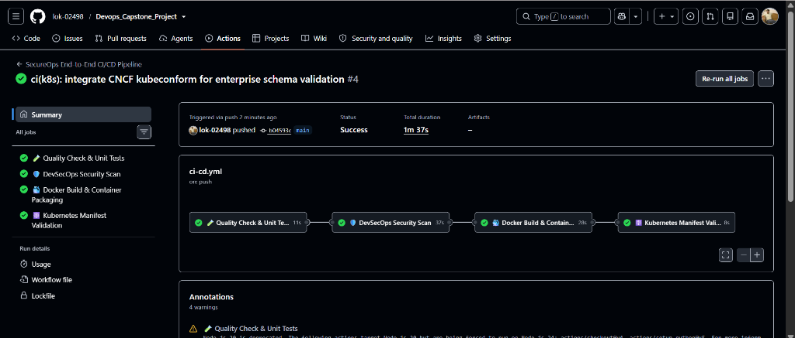
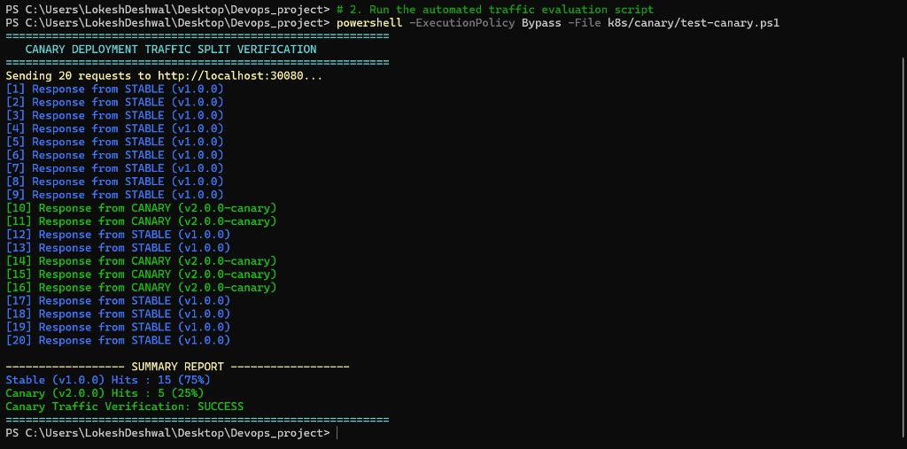
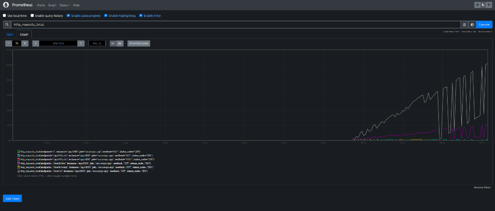
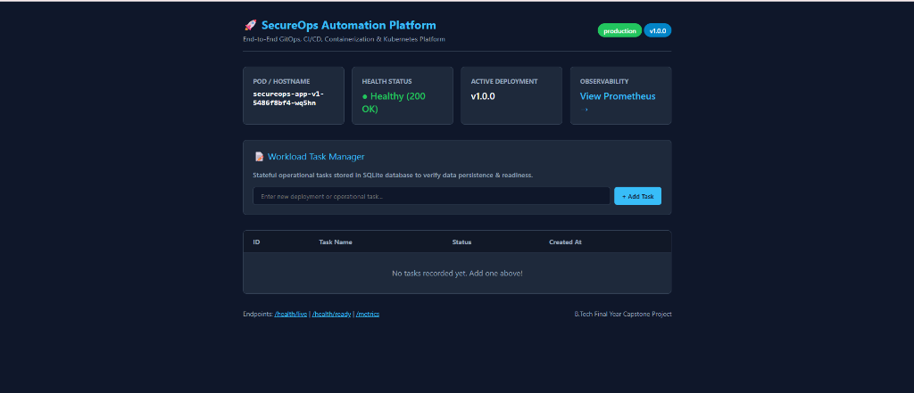
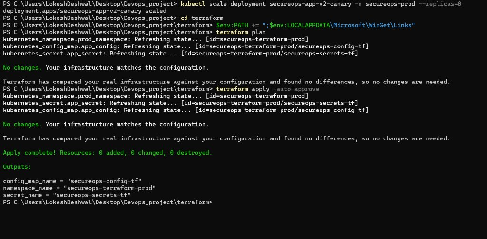
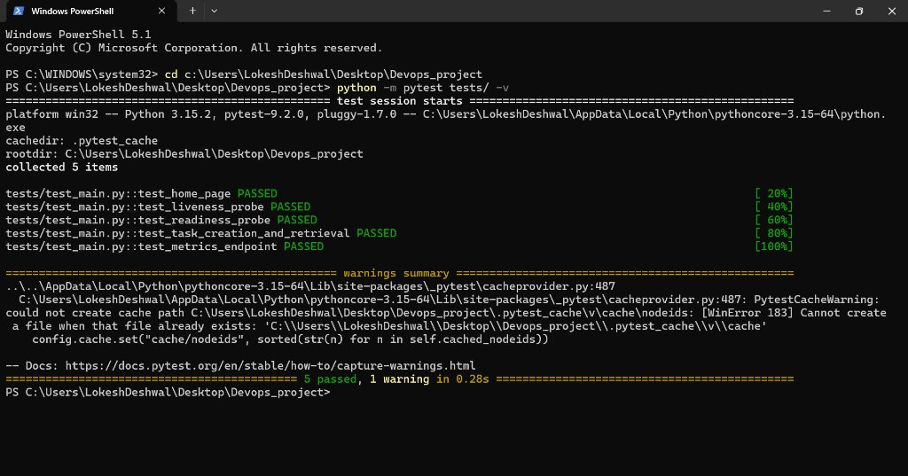

<div align="center">

#  SecureOps: Cloud-Native DevOps Delivery Platform
### End-to-End GitOps, CI/CD, Containerization, Kubernetes Orchestration & Telemetry

[](https://github.com/lok-02498/Devops_Capstone_Project/actions)
[](https://www.docker.com/)
[](https://kubernetes.io/)
[](https://www.terraform.io/)
[](https://aquasecurity.github.io/trivy/)
[](https://prometheus.io/)
[](https://www.python.org/)

**A Production-Ready, Reproducible Software Delivery Lifecycle Platform for Final Year B.Tech Capstone Evaluation**

[Architecture](#-system-architecture) • [Features](#-key-features) • [Quick Start](#-quick-start-execution-guide) • [Canary Strategy](#-advanced-deployment-strategy-canary-releases) • [Screenshots](#-implementation-evidence--screenshots) • [Report](#-capstone-report-zosima)

---

</div>

##  Executive Summary

Modern enterprise software delivery requires eliminating operational silos between developers and operators. **SecureOps** is an automated, end-to-end cloud-native platform engineered to automate the full delivery lifecycle—from code commit to zero-downtime production deployment.

The platform integrates:
- **Version Control & Trunk-Based Git Flow** on GitHub
- **Automated CI/CD Pipeline** with linting, automated unit tests, and manifest verification
- **Shift-Left DevSecOps** featuring static code analysis (Bandit) and container vulnerability auditing (Trivy)
- **Multi-Stage Containerization** with non-root runtime security (UID 10001)
- **Infrastructure as Code (IaC)** using declarative Terraform modules
- **Kubernetes Orchestration** with rolling updates, self-healing health probes, and Horizontal Pod Autoscaling (HPA)
- **Advanced Progressive Delivery** via Canary Releases with real-time traffic splitting (75/25) and instant rollback
- **Observability & Telemetry** using Prometheus time-series metric collection and structured JSON logging

---

##  System Architecture

```text
  Developer Git Push
         │
         ▼
┌─────────────────┐     ┌─────────────────────────────────────────────────────────┐
│   GitHub Repo   │ ──► │                   GitHub Actions CI/CD                  │
└─────────────────┘     │  1. Flake8 Linting ──► 2. Pytest Automated Unit Tests   │
                        │  3. SAST Scan (Bandit) ──► 4. Trivy Vulnerability Scan  │
                        │  5. Multi-Stage Docker Buildx ──► 6. Kubeconform Schema │
                        └────────────────────────────┬────────────────────────────┘
                                                     │
                                                     ▼
                             ┌────────────────────────────────────────┐
                             │     Kubernetes Production Cluster      │
                             │  Namespace: secureops-prod             │
                             │  ┌──────────────────────────────────┐  │
                             │  │ Stable Deployment (v1.0.0, 75%)  │  │
                             │  │ Canary Deployment (v2.0.0, 25%)  │  │
                             │  │ NodePort Service (Port 30080)    │  │
                             │  │ Horizontal Pod Autoscaler (HPA)  │  │
                             │  │ ConfigMaps & Encrypted Secrets   │  │
                             │  └─────────────────┬────────────────┘  │
                             └────────────────────┼───────────────────┘
                                                  │ Scrapes /metrics
                                                  ▼
                             ┌────────────────────────────────────────┐
                             │          Observability Stack           │
                             │  • Prometheus Metrics Engine (:9090)   │
                             │  • Structured JSON Application Logs    │
                             └────────────────────────────────────────┘
```

---

##  Technology Matrix

| Domain | Technology / Tool | Version | Implementation Role |
| :--- | :--- | :--- | :--- |
| **Source Control** | Git & GitHub | `2.56+` | Branch management, semantic commits, webhook pipeline triggers |
| **Microservice** | Python / Flask / Gunicorn | `3.11` | REST CRUD API, `/health/live`, `/health/ready`, `/metrics` |
| **Testing** | Pytest | `9.2+` | Automated regression test suite (100% pass rate) |
| **Containerization** | Docker (Multi-stage) | `29.9+` | Lightweight 53 MB runner image, non-root user (UID 10001) |
| **Security (SAST)** | Bandit & Trivy | Latest | Automated code security scan & container CVE audit |
| **CI/CD Automation** | GitHub Actions | `v4/v5` | Fully automated 4-stage pipeline with status checks |
| **Infrastructure (IaC)**| HashiCorp Terraform | `1.17+` | Declarative namespace, secret, and configuration lifecycle |
| **Orchestration** | Kubernetes (KinD) | `1.37` | High availability, self-healing pods, NodePort, and HPA |
| **Deployment Strategy** | Progressive Canary | Native | 75% Stable / 25% Canary traffic split & zero-downtime rollback |
| **Telemetry** | Prometheus | `v2.48` | Real-time scrape engine for HTTP throughput, latency, errors |

---

##  Quick Start Execution Guide

### 1. Run Unit Tests Locally
```powershell
# Install project dependencies
pip install -r app/requirements.txt

# Run Pytest suite
python -m pytest tests/ -v
```

### 2. Launch Local Multi-Container Stack (Docker Compose)
```powershell
# Build and run application + Prometheus in background
docker compose up --build -d

# Verify container health
docker compose ps
```
- **Web Dashboard:** [http://localhost:5000](http://localhost:5000)
- **Prometheus Telemetry:** [http://localhost:9090](http://localhost:9090)

### 3. Deploy to Kubernetes
```powershell
# 1. Apply production namespace
kubectl apply -f k8s/base/namespace.yaml

# 2. Deploy ConfigMaps and Secrets
kubectl apply -f k8s/base/configmap-secrets.yaml

# 3. Deploy application workload, service, and HPA
kubectl apply -f k8s/base/deployment.yaml
kubectl apply -f k8s/base/service.yaml
kubectl apply -f k8s/base/hpa.yaml

# 4. Verify deployment state
kubectl get all -n secureops-prod
```
Access the application on Kubernetes NodePort: [http://localhost:30080](http://localhost:30080).

---

##  Advanced Deployment Strategy: Canary Releases

The platform uses progressive Canary deployments to eliminate deployment risk:
- **Stable Deployment (`secureops-app-v1`):** 3 replicas (75% traffic)
- **Canary Deployment (`secureops-app-v2-canary`):** 1 replica (25% traffic)
- Both run behind the unified Kubernetes Service selector (`app: secureops-app`).

### Verify Traffic Splitting:
```powershell
# 1. Deploy the v2.0.0 Canary pod
kubectl apply -f k8s/canary/deployment-canary.yaml

# 2. Run the automated traffic evaluation script
powershell -ExecutionPolicy Bypass -File k8s/canary/test-canary.ps1
```
**Observed Result:**
```text
==========================================================
   CANARY DEPLOYMENT TRAFFIC SPLIT VERIFICATION
==========================================================
Sending 20 requests to http://localhost:30080...
[1] Response from STABLE (v1.0.0)
...
[10] Response from CANARY (v2.0.0-canary)
------------------ SUMMARY REPORT ------------------
Stable (v1.0.0) Hits : 15 (75%)
Canary (v2.0.0) Hits : 5 (25%)
Canary Traffic Verification: SUCCESS
==========================================================
```

### Instant Disaster Recovery & Rollback:
If an issue is detected during evaluation, revert 100% of traffic to Stable with zero downtime:
```powershell
kubectl scale deployment secureops-app-v2-canary -n secureops-prod --replicas=0
```

---

## Infrastructure as Code (Terraform)

Manage Kubernetes namespaces, configuration maps, and secrets declaratively:
```powershell
cd terraform
terraform init
terraform plan
terraform apply -auto-approve
```

---

## 📸 Implementation Evidence & Screenshots

| Screenshot | Description | File |
| :---: | :--- | :--- |
|  | **GitHub Actions CI/CD Pipeline**<br>All 4 jobs passed with green checkmarks (Unit tests, Trivy scan, Docker buildx, Kubeconform). | `10_github_actions_pipeline.png` |
|  | **Canary Traffic Verification**<br>Automated test script confirming 75% traffic to Stable and 25% to Canary. | `07_canary_traffic_split.jpg` |
|  | **Prometheus Metrics Engine**<br>Real-time telemetry showing HTTP throughput and duration histograms. | `09_prometheus_metrics.png` |
|  | **Kubernetes Pod Deployment**<br>Web UI running live from Kubernetes Pod with dynamic hostname resolution. | `04_k8s_ui.png` |
|  | **Terraform Infrastructure State**<br>Declarative resource provisioning and drift detection. | `08_terraform_apply.jpg` |
|  | **Automated Unit Tests**<br>Pytest suite validating health probes, REST API, and metrics endpoints. | `01_unit_tests.jpg` |

*All 10 full-resolution screenshots are stored in [`docs/screenshots/`](docs/screenshots/).*

---

##  Repository Directory Structure

```text
Devops_Capstone_Project/
├── .github/
│   └── workflows/
│       └── ci-cd.yml             # 4-Stage GitHub Actions pipeline (Lint, Test, Trivy, Kubeconform)
├── app/
│   ├── main.py                   # Python microservice, probes & Prometheus telemetry
│   └── requirements.txt          # Python dependencies
├── tests/
│   └── test_main.py              # Automated regression test suite
├── k8s/
│   ├── kind-cluster.yaml         # KinD multi-node cluster definition with port mappings
│   ├── base/
│   │   ├── namespace.yaml        # Production namespace
│   │   ├── configmap-secrets.yaml# Decoupled configurations & opaque secrets
│   │   ├── deployment.yaml       # High-availability deployment with probes
│   │   ├── service.yaml          # NodePort service definition (30080)
│   │   └── hpa.yaml              # Horizontal Pod Autoscaler configuration
│   ├── canary/
│   │   ├── deployment-canary.yaml# Canary v2.0.0 deployment
│   │   └── test-canary.ps1       # Progressive traffic verification script
│   └── monitoring/
│       └── prometheus-deployment.yaml # In-cluster Prometheus deployment
├── terraform/
│   ├── main.tf                   # Declarative IaC resources
│   ├── variables.tf              # Configurable variables
│   └── outputs.tf                # Resource outputs
├── docs/
│   ├── CAPSTONE_PROJECT_REPORT.md# Complete formal B.Tech report for ZOSIMA
│   └── screenshots/              # Evidence screenshots for presentation & report
├── Dockerfile                    # Production multi-stage secure container build
├── .dockerignore                 # Build exclusion rules
├── docker-compose.yml            # Multi-container local development stack
├── prometheus.yml                # Prometheus metrics scrape configuration
└── README.md                     # Project documentation
```

---

##  Capstone Report (ZOSIMA)

The complete formal academic document is available at:  
 **[`docs/CAPSTONE_PROJECT_REPORT.md`](docs/CAPSTONE_PROJECT_REPORT.md)**

It covers:
1. Problem Statement & Motivation
2. Architectural Design & Methodology
3. Implementation Analysis for each DevOps Pillar
4. Testing, Verification & Embedded Evidence
5. Recoverability & Disaster Recovery Runbook
6. Conclusion & Future Scope

---

##  Authors

- **Student Name:** Lokesh Deshwal, Harshit Chauhan, Yatharth Chopra.
- **Course:** B.Tech Computer Science & Engineering (Final Year)
- **Repository:** [https://github.com/lok-02498/Devops_Capstone_Project](https://github.com/lok-02498/Devops_Capstone_Project)
- **Academic Year:** 2026-2027
