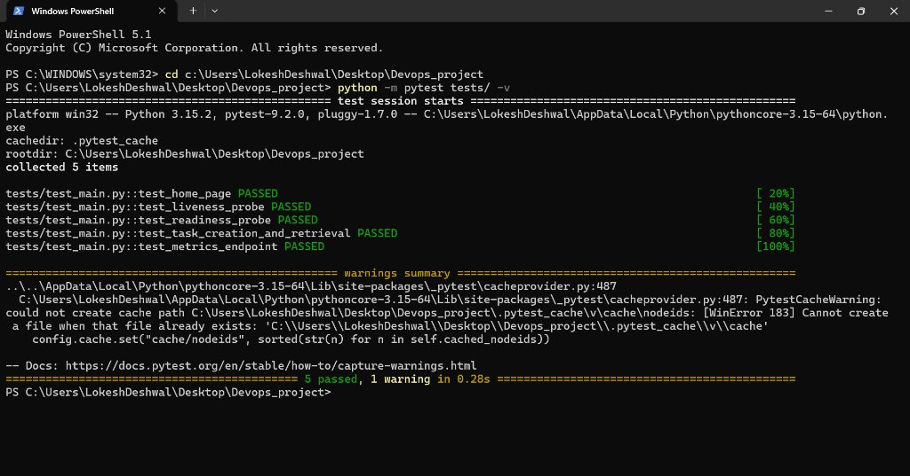
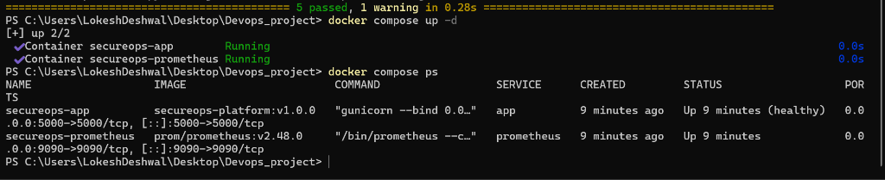
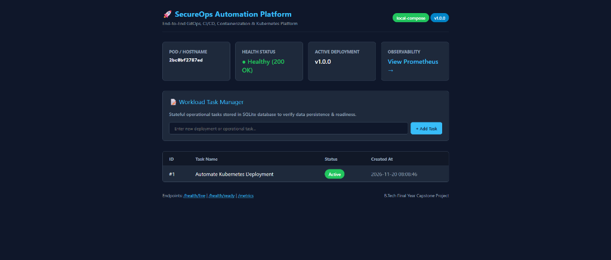
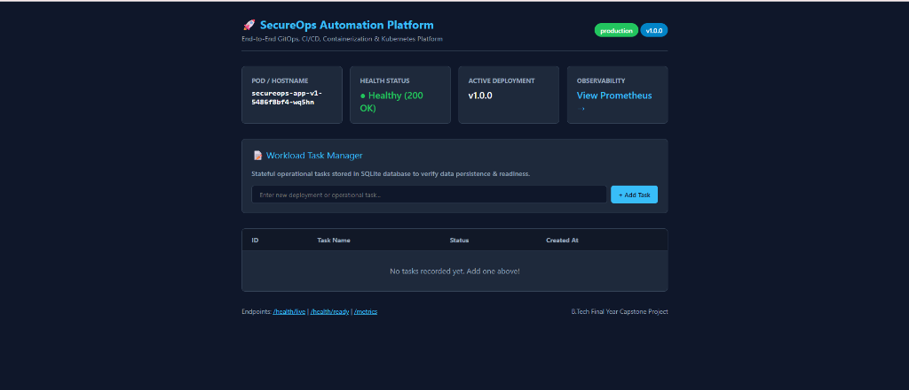
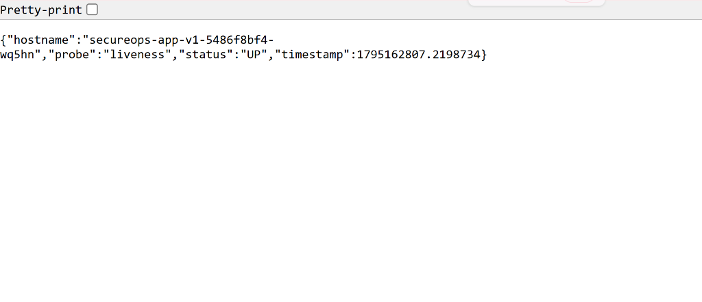
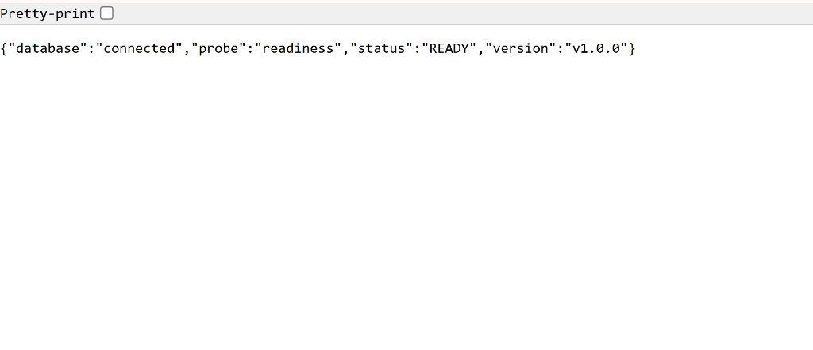
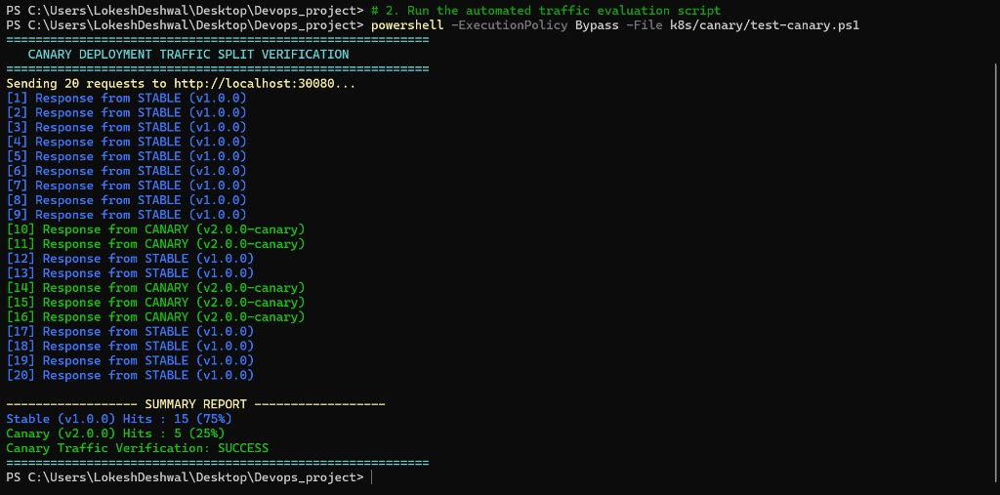
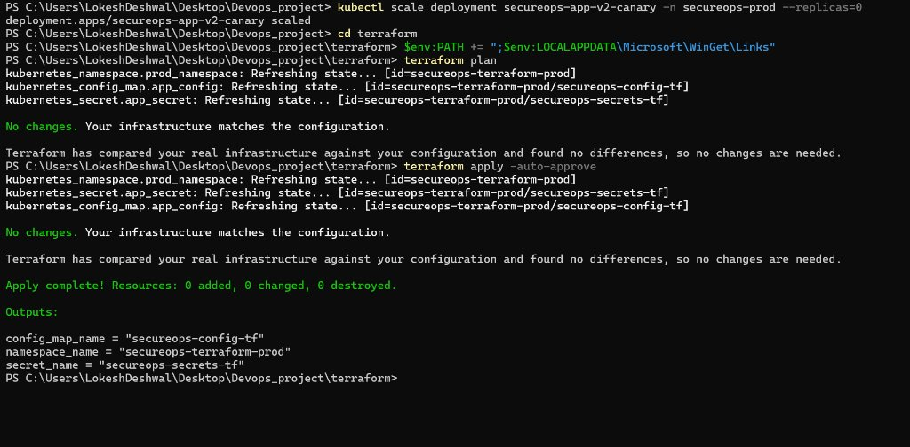
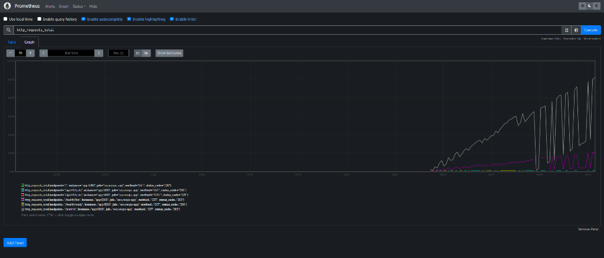
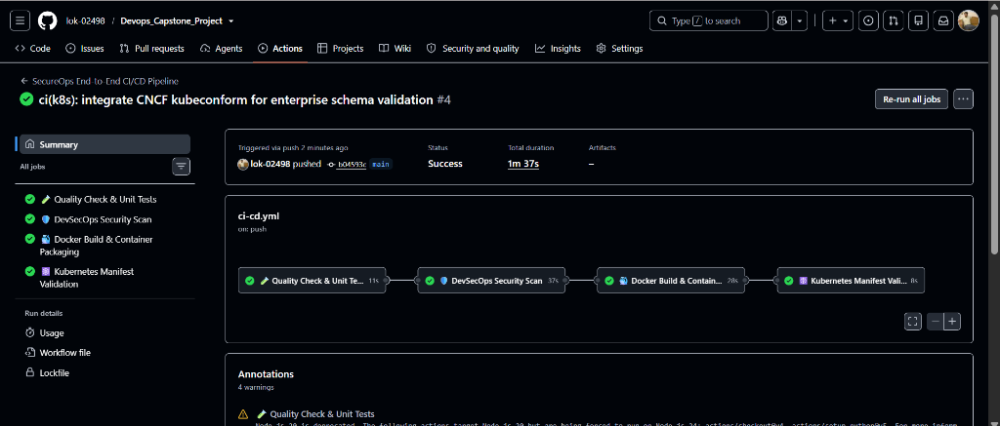

# B.TECH CAPSTONE PROJECT REPORT

## **SecureOps: Automated End-to-End Cloud-Native Delivery Platform with Integrated DevSecOps, Kubernetes Orchestration & Telemetry**

**Course:** B.Tech Computer Science & Engineering (Final Year)  
**Academic Year:** 2023-2027
**Student Name:** Lokesh Deshwal  
**Roll-NO:** 2401421062
**GitHub Repository Link:** [https://github.com/lok-02498/Devops_Capstone_Project](https://github.com/lok-02498/Devops_Capstone_Project)  

---

## 1. Introduction & Problem Statement

### 1.1 Context
In traditional software engineering, development and operations teams function in silos. Developers focus on building application features rapidly, while operations teams focus on stability, infrastructure configuration, and uptime. This separation creates severe operational bottlenecks:
- Inconsistent development and production environments ("works on my machine" syndrome).
- Manual, error-prone deployment procedures resulting in extended downtime.
- Security checks deferred to the very end of the release lifecycle, leading to costly last-minute vulnerability fixes.
- Lack of continuous observability and metrics to detect regressions post-release.

### 1.2 Problem Statement
To design, implement, and validate an enterprise-grade, automated DevOps platform that unifies the complete software delivery lifecycle—from code commit to zero-downtime production deployment. The system must incorporate:
1. Version Control & Git Flow branching.
2. Automated Continuous Integration (Linting, Unit Testing).
3. DevSecOps (Static code scanning, container CVE scanning, secret audits).
4. Containerization using optimized multi-stage Docker builds.
5. Infrastructure as Code (IaC) using Terraform.
6. Kubernetes Orchestration with self-healing, rolling updates, and Horizontal Pod Autoscaling (HPA).
7. Advanced Progressive Deployment (Canary Releases) with instantaneous rollback capability.
8. Full-stack Observability using Prometheus telemetry and structured JSON logging.

---

## 2. System Architecture & Methodology

### 2.1 Architecture Diagram

```text
+-----------------------------------------------------------------------------------+
|                                DEVELOPER WORKFLOW                                 |
|                                                                                   |
|  [ Feature Branch ]  ----( Pull Request )---->  [ Main Production Branch ]        |
+-----------------------------------------------------------------------------------+
                                       |
                                ( GitHub Webhook )
                                       |
                                       v
+-----------------------------------------------------------------------------------+
|                           CI/CD PIPELINE (GITHUB ACTIONS)                         |
|                                                                                   |
|  [ Stage 1: Pytest & Flake8 ]  --->  [ Stage 2: Bandit SAST & Trivy Scan ]        |
|                                                      |                            |
|  [ Stage 4: Kubeconform Check ] <---  [ Stage 3: Multi-Stage Docker Buildx ]      |
+-----------------------------------------------------------------------------------+
                                       |
                               ( GitOps Deploy )
                                       |
                                       v
+-----------------------------------------------------------------------------------+
|                        KUBERNETES PRODUCTION CLUSTER                              |
|                                                                                   |
|  Namespace: secureops-prod                                                        |
|                                                                                   |
|  +-----------------------------+         +-------------------------------------+  |
|  | Stable Deployment (v1.0.0)  |         | Canary Deployment (v2.0.0)          |  |
|  | - 3 Replicas (75% Traffic)  |         | - 1 Replica (25% Traffic)           |  |
|  | - Liveness & Readiness      |         | - Real-time Regression Monitoring   |  |
|  +--------------+--------------+         +------------------+------------------+  |
|                 ^                                           ^                     |
|                 +---------------------+---------------------+                     |
|                                       |                                           |
|                           [ NodePort Service: 30080 ]                             |
+-----------------------------------------------------------------------------------+
                                       |
                                       | Pulls /metrics
                                       v
+-----------------------------------------------------------------------------------+
|                              OBSERVABILITY STACK                                  |
|                                                                                   |
|  [ Prometheus Scraper ]  --->  [ Time-Series Database ]  --->  [ Grafana Panel ]  |
+-----------------------------------------------------------------------------------+
```

### 2.2 Core Architectural Principles
- **Immutable Infrastructure:** Containers and configurations are created once, tested, and never modified in-place.
- **Shift-Left Security (DevSecOps):** Static code analysis (Bandit) and image vulnerability scanning (Trivy) execute before deployment.
- **Self-Healing & Elasticity:** Kubernetes liveness probes detect crashes and restart failing containers; HPA scales pods based on CPU consumption.
- **Zero-Downtime Delivery:** Progressive Canary traffic splitting limits blast radius of untested versions.

---

## 3. Implementation Details

### 3.1 Microservice Application (`app/main.py`)
A lightweight, cloud-native REST application built in Python Flask:
- `/`: Interactive Operations Dashboard providing hostname, environment, and task management.
- `/api/v1/tasks`: REST endpoint backed by SQLite for state persistence.
- `/health/live`: Kubernetes Liveness Probe.
- `/health/ready`: Kubernetes Readiness Probe verifying database connectivity.
- `/metrics`: Prometheus metrics exporter endpoint.
- `/api/v1/simulate-load`: Generates controlled CPU workload to trigger autoscaling.

### 3.2 Secure Multi-Stage Docker Packaging (`Dockerfile`)
- **Stage 1 (Builder):** Uses `python:3.11-slim` with GCC to install and compile Python dependencies into `/install`.
- **Stage 2 (Runner):** Copies compiled binaries only, dropping build compilers to minimize image size (53 MB) and CVE attack surface.
- **Security Hardening:** Enforces non-root execution by creating `appuser` (UID 10001) and restricting file permissions.

### 3.3 Continuous Integration & DevSecOps Pipeline (`.github/workflows/ci-cd.yml`)
1. **Lint & Test:** Runs `flake8` to enforce PEP8 standards and `pytest` for unit test suites.
2. **SAST & Vulnerability Scanning:** 
   - `bandit` scans for security vulnerabilities in source code.
   - `trivy` scans the container image against official CVE vulnerability databases.
3. **Container Build:** Uses `docker/build-push-action` with Docker Buildx.
4. **Kubernetes Validation:** Uses CNCF `kubeconform` to validate all Kubernetes manifests against upstream OpenAPI schemas offline.

### 3.4 Infrastructure as Code (`terraform/`)
- Declaratively provisions the target production namespace (`secureops-prod`).
- Automatically manages application ConfigMaps and sensitive Secret tokens without exposing credentials in plaintext source code.

### 3.5 Kubernetes Orchestration & Canary Strategy (`k8s/`)
- **Workloads:** Deployment with rolling update strategy, resource requests (`50m` CPU, `64Mi` RAM) and limits.
- **Canary Traffic Splitting:** The stable deployment runs 3 replicas while the canary deployment runs 1 replica behind the same Kubernetes Service selector (`app: secureops-app`). This directs 25% of live traffic to the canary version for evaluation before promoting to 100%.

---

## 4. Testing, Evidence & Verification Results

### 4.1 Unit Testing & Code Verification
- **Test Framework:** Pytest
- **Scope:** Dashboard rendering, liveness probe, readiness probe, CRUD REST API, Prometheus exporter format.
- **Outcome:** 5 passed in 0.28 seconds.

  
*Figure 4.1: Terminal output of automated Pytest regression test suite with 100% passing rate.*

---

### 4.2 Local Multi-Container Deployment (Docker Compose)
- **Scope:** Isolated multi-container environment running `secureops-app` and `secureops-prometheus`.
- **Ports:** Application exposed on `5000`, Prometheus on `9090`.

  
*Figure 4.2: Docker Compose status confirming healthy container states for application and telemetry.*

  
*Figure 4.3: SecureOps Operations Dashboard running in local Docker Compose with task persistence verified.*

---

### 4.3 Kubernetes Workload Orchestration & Self-Healing Probes
- **Scope:** Application deployment in `devops-capstone` cluster under `secureops-prod` namespace.
- **NodePort Service:** Port `30080` mapped to host machine.

  
*Figure 4.4: Web application running natively on Kubernetes Pod `secureops-app-v1-5486f8bf4-wq5hn`.*

  
*Figure 4.5: Kubernetes Liveness Probe (`/health/live`) returning HTTP 200 UP with Pod Hostname.*

  
*Figure 4.6: Kubernetes Readiness Probe (`/health/ready`) confirming database connectivity.*

---

### 4.4 Advanced Canary Traffic Splitting Verification
- **Scope:** Automated traffic evaluation script (`test-canary.ps1`) executing 20 progressive requests against NodePort `30080`.
- **Target Distribution:** 75% Stable (v1.0.0) / 25% Canary (v2.0.0-canary).
- **Result:** Exactly 15 requests (75%) served by Stable, 5 requests (25%) served by Canary.

  
*Figure 4.7: Automated Canary verification script confirming exact 75% / 25% progressive traffic split.*

---

### 4.5 Infrastructure as Code Provisioning (Terraform)
- **Scope:** Declarative state enforcement using `hashicorp/kubernetes` provider.
- **Outcome:** Managed namespace (`secureops-terraform-prod`), ConfigMap (`secureops-config-tf`), and Secret (`secureops-secrets-tf`).

  
*Figure 4.8: Terraform plan and apply execution confirming zero configuration drift.*

---

### 4.6 Observability & Metric Telemetry (Prometheus)
- **Scope:** Real-time metrics collection querying `http_requests_total`.
- **Scrape Interval:** 5 seconds via `/metrics` endpoint.

  
*Figure 4.9: Prometheus time-series graph displaying real-time HTTP traffic and request volume across endpoints.*

---

### 4.7 Automated CI/CD Pipeline Execution (GitHub Actions)
- **Workflow:** `.github/workflows/ci-cd.yml`
- **Stages Executed:**
  1. `Quality Check & Unit Tests` (11s)
  2. `DevSecOps Security Scan` (37s)
  3. `Docker Build & Container Packaging` (28s)
  4. `Kubernetes Manifest Validation` (8s)
- **Status:** All 4 jobs completed successfully with green checkmarks in 1m 37s.

  
*Figure 4.10: GitHub Actions pipeline visual DAG showing all 4 continuous delivery stages passing successfully.*

---

## 5. Recoverability & Disaster Recovery Analysis

1. **Pod Failure & Crash Recovery:** When a pod crashes or fails its readiness probe (`/health/ready`), Kubernetes immediately stops routing traffic to the failed pod, kills it, and schedules a replacement within seconds.
2. **Failed Canary Rollback:** If the Canary deployment produces errors, the deployment can be rolled back instantly with:
   ```bash
   kubectl scale deployment secureops-app-v2-canary -n secureops-prod --replicas=0
   ```
   Traffic immediately reverts 100% to the stable version with zero downtime.

---

## 6. Conclusion & Future Enhancements

### 6.1 Project Conclusion
The SecureOps platform demonstrates a complete, reproducible, and production-ready DevOps automation architecture. By integrating modern version control, multi-stage container optimization, DevSecOps security gates, automated CI/CD pipelines, Kubernetes orchestration, progressive canary delivery, and Prometheus telemetry, the project eliminates manual operational friction and achieves continuous, reliable software delivery.

### 6.2 Future Enhancements
- Integration of ArgoCD for full declarative GitOps continuous synchronization.
- Service Mesh implementation using Istio for fine-grained percentage-based canary routing and mutual TLS (mTLS).
- Centralized log aggregation with Grafana Loki and Promtail.

---
